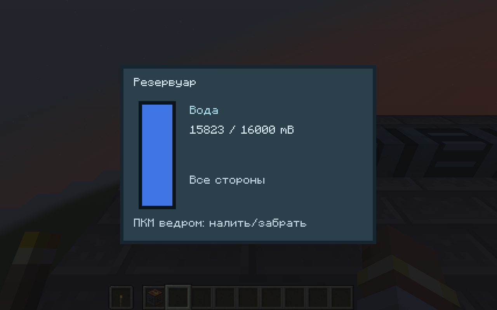

# Fluid logistics — 0.6.0

Target: Minecraft 1.21.1 / NeoForge 21.1.252 / Java 21. All quantities use integer millibuckets (mB); one vanilla bucket is 1000 mB. Simulation runs on the server at 20 ticks/second.

## Usable blocks

| Block | Capacity | Connections / behavior |
|---|---:|---|
| Fluid pipe | 1000 mB | six adjacent faces; passive finite flow |
| Fluid tank | 16000 mB | six adjacent faces; passive finite flow |
| Electric pump | 1000 mB | horizontal back input/front output; no side fluid ports; 16000 FE buffer |

The arrow on the pump points toward its output; right-click with the factory wrench rotates it. Normal pole coverage powers pumps; guarded external NeoForge energy input also works. Passive pipes/tanks need no power. A pump spends **20 FE once per working tick**, whether one or both ports move, with a **100 mB/tick per-port upper bound** (2000 mB/s at 20 TPS). It stops without energy, supply or available capacity. Filling a free chamber can still consume energy while downstream is blocked; a full blocked chamber consumes none.

The pump accepts a genuine vanilla source-water block immediately behind it as unlimited offshore-style input; it does not remove that world source. Flowing/waterlogged blocks and other world fluids are not extracted. Finite containers are actually drained. Passive cells can hold any registered FluidStack, including vanilla lava and component-bearing fluids. Empty cells accept one identity; incompatible fluids or components never mix. Pump intake/output use the chamber present before that tick's port planning, so newly collected water cannot pass straight through an empty pump in the same tick.

Right-click with a bucket for standard NeoForge container interaction; right-click otherwise for a readonly gauge (and pump FE). Standard sided fluid capabilities allow other mods to push/pull; pipe/pump automatic neighbor discovery currently connects only FactoryCraft fluid nodes. Unsided pump access exposes maintenance fill/drain; sided access enforces back/front roles even on a previously cached handler after rotation.

Breaking a filled block returns one block item retaining the canonical native FluidStack (including components) and stored FE. Freshly crafted items stack normally; harvested structures retain controller NBT. Place the returned item to restore contents. Standard creative breaking produces no block item. Tanks are now 3×3×3 and pumps occupy 1×2, automatically formed from one item. Pipes remain one block. External tank faces and fixed pump nozzles forward to one controller; see MACHINE_DIMENSIONS.md.

## Chosen transport model and Factorio 2.0 comparison

Factorio 2.0 groups connected pipes/storage into fluid segments with shared fluid levels and uses pumps between segments. FactoryCraft currently implements a **finite local-pressure approximation** with per-block buffers and explicit edge throughput. Distance and junction degree therefore affect equalization time, unlike a shared uniform-level segment. It is not exact Factorio 2.0 fluid parity. Reference: <https://wiki.factorio.com/Fluid_system> (2.0 model). No Factorio code or assets are used.

Adjacent passive cells form a cached graph; pump chambers separate passive components. For one edge with pre-phase amounts Va/Vb, capacities Ca/Cb and passive degrees da/db, request:

```
q = min(100, floor(abs(Va*Cb - Vb*Ca) / ((Ca+Cb)*max(1,da,db))))
```

Direction is from higher to lower fill fraction. Then clamp against reserved source volume and destination free space. Degree damping prevents the six-way-junction oscillation of simultaneous unrestricted pair equalization. Integer rounding can leave a small residual difference; exact uniformity and a fixed end-to-end throughput are not promised. Gravity, pressure damage, temperature and viscosity are not simulated. Pump pressure can fill a tank toward capacity rather than merely equalize the upstream fraction.

Each batch first reserves all transfers, then drains all sources, fills all targets, and only then invokes observers. A newly received parcel cannot relay in the same graph tick; observer failure cannot replay a committed plan. Fill/drain simulation does not mutate state. Restoring volume above nominal capacity preserves it as drainable overflow instead of deleting it; subsequent filling is blocked until space is available.

## Scheduling, persistence and diagnostics

Graph nodes/edges update on actual topology changes. Empty, balanced and incompatible edges sleep until content/topology changes; pumps sleep when blocked/unpowered/empty and wake on relevant fluid, energy or neighbor changes. `fluidWorkPerTick` defaults to 16384 (range 64–1048576), limiting passive edge visits and pump jobs separately per level tick. FIFO queues retain backlog; limiting work slows propagation, never discards volume. Cached component counts are computed on a diagnostic request after topology revision, rather than scanning the factory each tick.

Runtime never force-loads neighbors. Canonical loaded chunk/BE ownership is checked before access. An unavailable endpoint freezes transfers; early ChunkEvent.Unload detaches before chunk serialization, and every authoritative change marks its owned chunk unsaved immediately. This specifically covers the save-order race found by a four-chunk disk fixture. Unloaded fluid nodes do not advance offline.

New block entities use fluid schema 1 and the native FluidStack codec. Production/fluid/belt payloads stay native; assembly/part metadata is schema 3 in 0.6.0. Fluid snapshot changes are staggered per position to at most one BE packet per five ticks; opened menus use vanilla data slots and split 32-bit quantities safely. No measured multiplayer delta compression is claimed.

`/factorycraft fluids` reports loaded nodes, passive components/edges, pending edges, queued pumps, cumulative edge visits/transferred mB, pump chamber transfers and CPU time. Pump chamber transfers count both input and output movement, not unique water creation or end-to-end throughput.

`/factorycraft waterworks` requires an empty loaded 30×8×13 area beside the player and builds a real fueled generator → pole → pump → four pipes → tank chain with an enclosed source-water block. It does not fill the destination tank directly.



## Evidence and next work

JUnit covers storage simulation/atomicity/overflow, component-style identities, sleeping/wakeup, topology/splits, budget fairness, blocked/unavailable endpoints, callback ordering/failure, six-way stability and a randomized 10000-cell conservation graph. Dedicated GameTests exercise real NeoForge ports, buckets and harvested-item placement, powered world-water supply, vertical flow, live NBT reload, early chunk unload and exact 8000 mB persistence across four chunks in separate JVMs. See VALIDATION.md for results and limits. The pure 10000-cell exercise is not an in-world fluid TPS benchmark.

Water-to-steam boilers and steam engines are delivered in 0.4.0: see STEAM_POWER.md. Thermal devices actively pull/push through their oriented FactoryCraft connections; they do not join passive pressure components. Mixed item/fluid recipes, finite oil, basic refining, plastic and sulfur are delivered in 0.5.0; see PETROLEUM.md. Advanced refining/cracking, lubricant, acid and batteries are delivered in 0.8.0; team research is next. Underground pipes, external-node discovery, pump circuit controls, fluid rendering within pipe models, temperature and production graphs remain unimplemented. Two real clients and natural player-distance unload still need separate validation.

### Native buckets and data components (0.4.0)

NeoForge's standard bucket wrapper cannot retain component-bearing FluidStacks. FactoryCraft empty-bucket block interaction refuses that lossy operation and leaves volume/components intact with a translated explanation. Plain water/lava/steam remain bucket-compatible. Carry the filled block or use a component-aware fluid container/capability for customized fluids. Steam also refuses this conversion through its FluidType bucket factory.

## 0.8.0 petroleum extension

Heavy oil, light oil, lubricant and sulfuric acid use the same component-sensitive finite cells, native guarded capabilities and plain buckets. No pressure/capacity/throughput solver change is made. The refinery adds only a fifth 4000-mB cell/third active 100-mB/t nozzle at its front-left controller face; legacy cells/ports do not move. Chemical plants keep two fluid inputs/two outputs, while refinery recipes reserve three results together. See PETROLEUM.md for exact recipes, coordinates, schema migration and full-line ledger. Neither this extension nor the automated example certifies a large petrochemical TPS target.

## 0.10.0 — exact-volume canister and input recovery

The reusable `factorycraft:fluid_canister` holds **4000 mB**, has a standard NeoForge item fluid capability and stores native `SimpleFluidContent` in the persistent/network-synchronized `factorycraft:canister_fluid` data component. Fluid components and any sub-bucket volume survive item serialization and networking. The craft uses seven iron plates, one pipe and one glass. Right-click physical fluid ports/tanks to transfer through the existing native FluidUtil interaction; directional machine inputs remain fill-only for ordinary external capabilities.

To remove leftover fluid from either input of a refinery, chemical plant or assembling machine 2, carry a canister **on the mouse cursor** and press the small ↑ button beside that input row. The server validates current menu, range, spectator state, canonical loaded controller and complete assembly. It fills a private canister copy, commits the source remainder and cursor owner before fluid observers, and then lets ordinary menu synchronization send the new item. A full/mismatched canister changes nothing. Overflow restored in a machine is drained only up to available canister space; e.g. 5001 mB becomes 4000 + 1001, never truncated or rounded to buckets. Partial recipe work stays paused until adequate input returns; recovery neither refunds FE nor grants a result. This is a synchronous game-state transaction, not a cross-file crash write-ahead journal.

The cursor remains vanilla container ownership: closing/disconnecting returns it according to Minecraft's menu rules. Recovery does not discard fluid, open input drains to pipe networks, change the finite-pressure solver, or create fluid entities. Pumpjacks have no recovery buttons because their only active reservoir is an output. Canisters work with normal output/tank interactions as well.
