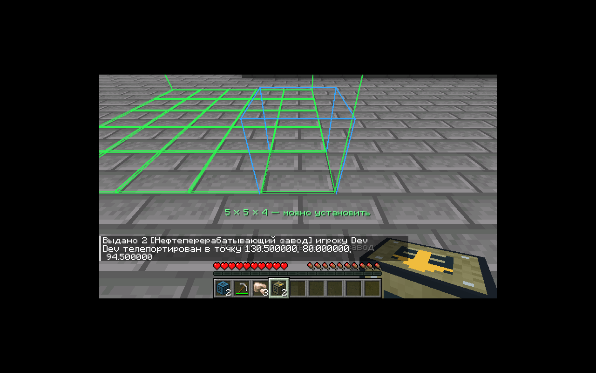
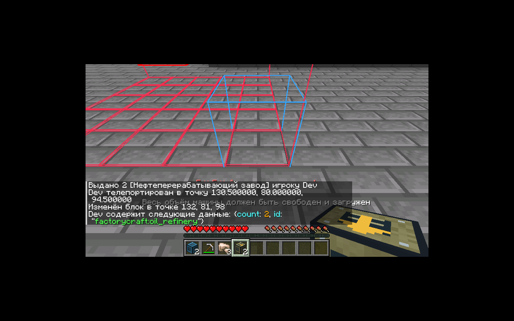

# Габариты машин / Machine footprints — 0.6.0

Одна плитка Factorio = один блок Minecraft по горизонтали. Factorio задаёт площадь, а не высоту воксельного здания: высоты ниже — собственное решение FactoryCraft. Проверяется и занимается **весь объём**, включая верхние ячейки. Корпус пока использует временные оригинальные панельные текстуры; окончательные модели механизмов ещё предстоит сделать.

| Машина | Ширина × глубина | Высота | Прототип / назначение |
|---|---:|---:|---|
| Электрический бур | 3×3 | 2 | electric-mining-drill; добывающая область 5×5 |
| Электропечь | 3×3 | 3 | electric-furnace |
| Сборочный автомат | 3×3 | 3 | assembling-machine-1 |
| Угольный генератор | 3×3 | 3 | собственный стартовый генератор; точного аналога в Factorio нет |
| Промышленная печь | 3×3 | 3 | собственный ускоренный вариант electric-furnace |
| Нефтяная помпа | 3×3 | 4 | pumpjack |
| НПЗ | 5×5 | 4 | oil-refinery |
| Химический завод | 3×3 | 3 | chemical-plant |
| Котёл | 3×2 | 2 | boiler |
| Паровой двигатель | 3×5 | 2 | steam-engine |
| Резервуар | 3×3 | 3 | storage-tank |
| Электрический насос | 1×2 | 1 | pump; забор природной воды — адаптация FactoryCraft |
| Разделитель | 2×1 | 1; коллизия 3/16 | splitter; два передних выхода |

Обычные конвейеры, трубы, манипулятор и столб остаются в пределах одной плитки. Производственные скорости и внутренняя модель жидкостей пока сохраняют документированный баланс FactoryCraft. Размер разделителя исправлен, но его текущий контроллер содержит две общие полосы, а не две полные независимые ленты: полная пропускная способность Factorio, приоритеты и фильтры ещё не реализованы.

Размеры сверены с `selection_box` оригинальных прототипов из [factorio-data](https://github.com/wube/factorio-data/tree/master/base/prototypes/entity). Это справочник чисел, код и ресурсы Factorio в мод не включены. Целевая механическая база — Factorio 2.0; поддержка Space Age пока в плане.

## Установка и превью

Держите предмет машины и наведите на место установки. Зелёная рамка показывает свободный объём, красная — недопустимый; препятствия выделяются отдельно. Синяя ячейка обозначает контроллер: передний левый нижний угол. Машина растёт вправо, вверх и назад относительно стрелки машины, направленной к игроку. Подпись показывает ширину, глубину и высоту. Корпус растёт от игрока, поэтому НПЗ 5×5 можно поставить с обычной дистанции в выживании. Разделитель смотрит по ходу обычных лент — от игрока. Поверните игрока до установки для изменения ориентации.

`PlacementPlan.inspect` используется и клиентским превью, и серверным `MachineItem`. Сервер повторно проверяет все ячейки: границы/высоту мира, доступность чанков, заменяемость, существующие BE, коллизии существ и разрешения. Один предмет формирует все части в обычной NeoForge multi-place транзакции; отмена события возвращает мир и предмет. Превью не предсказывает решения сторонних серверных обработчиков защиты территории.

ПКМ по любой части открывает меню контроллера. Автоматизация предметов и FE обращается к единственному владельцу. Жидкости доступны через наружные патрубки: вход по центру задней грани, выход по центру передней; дополнительные химические порты — по центру левой/правой граней. Все внешние грани резервуара подключаемы. Труба у внутренней грани корпуса не соединяется с жидкостью.

Shift + ключ снимает всю машину одним предметом с её инвентарём, FE, жидкостями и прогрессом. То же происходит при разрушении любой части в выживании; структурные части отдельно не выпадают. При новой установке назначается новая UUID, старая `Assembly` в переносимый предмет не записывается. Для поворота установленной крупной машины снимите и установите её заново.

## Сохранение

Схема сборки/частей — 3. Части содержат только позицию/UUID владельца, не копии его ресурсов. Производство и capabilities останавливаются при недоступности любой части. Ранний ChunkEvent.Unload отключает порты до снимка сохранения; загрузка восстанавливает связи. Старые компактные миры не мигрируются по явному разрешению пользователя. **Для 0.6.0 создайте новый мир.**

