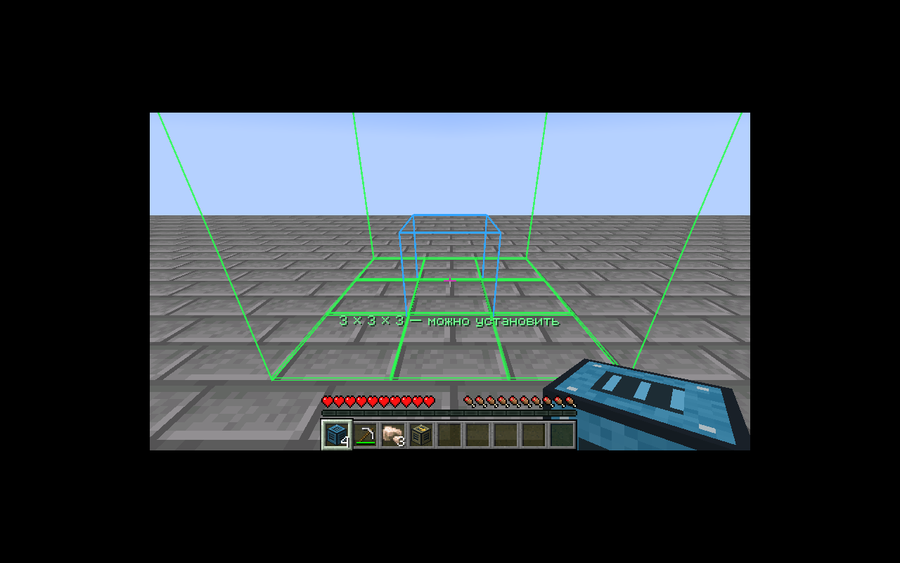
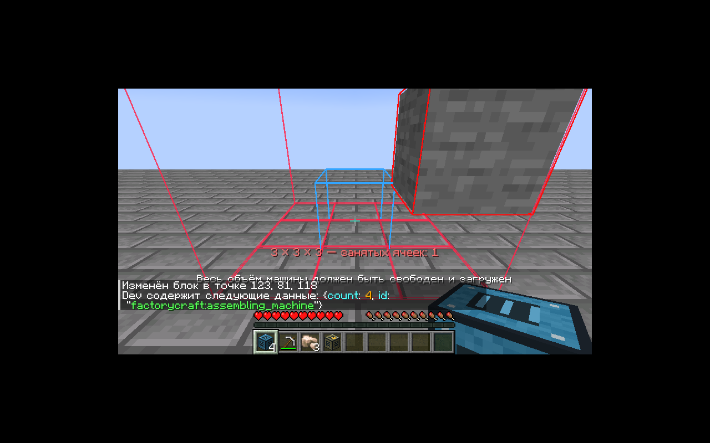

# Габариты машин / Machine footprints — 0.9.0

Одна плитка Factorio = один блок Minecraft по горизонтали. Factorio задаёт площадь, а не высоту воксельного здания: высоты ниже — собственное решение FactoryCraft. Проверяется и занимается **весь объём**, включая верхние ячейки. Все 14 типов используют собственные цельные модели; визуальные промежутки внутри рамы не уменьшают занятый объём.

| Машина | Ширина × глубина | Высота | Прототип / назначение |
|---|---:|---:|---|
| Электрический бур | 3×3 | 2 | electric-mining-drill; добывающая область 5×5 |
| Электропечь | 3×3 | 3 | electric-furnace |
| Сборочный автомат | 3×3 | 3 | assembling-machine-1 |
| Угольный генератор | 3×3 | 3 | собственный стартовый генератор; точного аналога в Factorio нет |
| Промышленная печь | 3×3 | 3 | собственный ускоренный вариант electric-furnace |
| Нефтяная помпа | 3×3 | 4 | pumpjack |
| НПЗ | 5×5 | 4 | oil-refinery |
| Химический завод | 3×3 | 3 | chemical-plant |
| Котёл | 3×2 | 2 | boiler |
| Паровой двигатель | 3×5 | 2 | steam-engine |
| Резервуар | 3×3 | 3 | storage-tank |
| Электрический насос | 1×2 | 1 | pump; забор природной воды — адаптация FactoryCraft |
| Разделитель | 2×1 | 1; коллизия 3/16 | splitter; две ленты, четыре полосы, два передних выхода |

Обычные конвейеры, трубы, манипулятор и столб остаются в пределах одной плитки. Производственные скорости и внутренняя модель жидкостей пока сохраняют документированный баланс FactoryCraft. Разделитель содержит две физические ленты / четыре полосы с общей проверенной скоростью насыщенных входов 30 предметов/с в независимом ядре. Манипуляторы обращаются к своей половине. Приоритеты и фильтры ещё не реализованы; см. SPLITTERS.md.

Размеры сверены с `selection_box` оригинальных прототипов из [factorio-data](https://github.com/wube/factorio-data/tree/master/base/prototypes/entity). Это справочник чисел, код и ресурсы Factorio в мод не включены. Целевая механическая база — Factorio 2.0; поддержка Space Age пока в плане.

## Установка и превью

Держите предмет машины и наведите на **центральную ячейку основания**. Зелёная/красная рамка показывает свободный/недопустимый объём, препятствия выделяются отдельно. Синяя ячейка — выбранный центр. Машины 3×3 и 5×5 растут симметрично относительно неё по горизонтали; высота отсчитывается вверх от основания. Для чётной стороны (насос 1×2, котёл 3×2, разделитель 2×1) центральная ячейка выбирается по индексу `floor(size/2)` от левого/переднего края: из двух средних — правая/задняя относительно стрелки. Поверните игрока до установки, превью пересчитается.

Существующие структуры 0.6.0 остаются на своих местах. Внутренний контроллер по-прежнему хранится в переднем левом нижнем углу; это техническая деталь сохранения. Выбор центра автоматически пересчитывается в его позицию, включая обычное применение переносимых NBT/components BlockItem. Игрок устанавливает машину от центра; дополнительные предметы частей не нужны.

`PlacementPlan.inspect` используется и клиентским превью, и серверным `MachineItem`. Сервер повторно проверяет все ячейки: границы/высоту мира, доступность чанков, заменяемость, существующие BE, коллизии существ и разрешения. Один предмет формирует все части в обычной NeoForge multi-place транзакции; отмена события возвращает мир и предмет. Превью не предсказывает решения сторонних серверных обработчиков защиты территории.

ПКМ по любой части открывает меню контроллера. Автоматизация предметов и FE обращается к единственному владельцу. Жидкости доступны через наружные патрубки: вход по центру задней грани, выход по центру передней; дополнительные химические порты — по центру левой/правой граней. Все внешние грани резервуара подключаемы. Труба у внутренней грани корпуса не соединяется с жидкостью.

Shift + ключ снимает всю машину одним предметом с её инвентарём, FE, жидкостями и прогрессом. То же происходит при разрушении любой части в выживании; структурные части отдельно не выпадают. При новой установке назначается новая UUID, старая `Assembly` в переносимый предмет не записывается. Для поворота установленной крупной машины снимите и установите её заново.

## Сохранение

Схема сборки/частей — 3. Части содержат только позицию/UUID владельца, не копии его ресурсов. Производство и capabilities останавливаются при недоступности любой части. Ранний ChunkEvent.Unload отключает порты до снимка сохранения; загрузка восстанавливает связи. Старые компактные миры не мигрируются по явному разрешению пользователя. **Для 0.6.0 создайте новый мир. Обновление 0.6.0+ → 0.8.0 не требует нового мира: сохранённые структуры не перемещаются.**

В 0.7.0 все типы используют цельные оригинальные модели вместо повторяющихся панелей. Видимые промежутки между рамой/баками остаются частью занятого объёма и имеют прежнюю коллизию; внутрь машины ставить блоки нельзя. Синие патрубки — вход, оранжевые — выход, бирюзовые — двусторонние. Стрелки дополняют цвет. У резервуара отмечены удобные точки, но доступны все наружные грани. См. [MACHINE_VISUALS.md](MACHINE_VISUALS.md).

НПЗ 0.8.0 имеет третий выход **спереди слева**, отмеченный **3**; прежние входы и два выхода не перемещаются. Его пятая ёмкость существует только у контроллера. Габариты/коллизия/установка от центра остаются прежними. Подробная карта портов и порядок жидкостей — в [PETROLEUM.md](PETROLEUM.md).

Лаборатория 0.9.0 — 3×3×3, один предмет/вся структура, та же центрированная установка. Только контроллер хранит научные пакеты, FE, работу и привязку команды.

0.10.0: `assembling_machine_2` — **3×3**, высота **3**. Одноимённый профиль добавлен в конец enum; существующие профили/схема 3 не меняются. Один предмет формирует все 27 ячеек от центра основания. Патрубки смешанного сборщика: входы сзади/слева, выходы спереди/справа; стандартные рецепты расходуют только задний вход.
