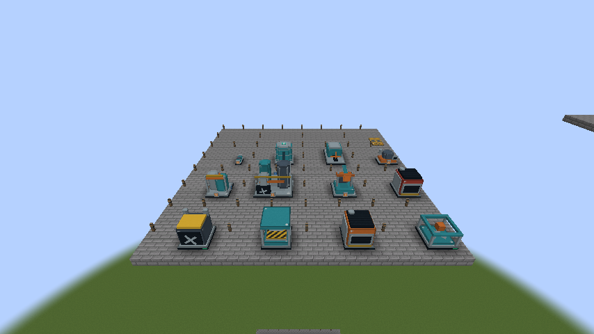
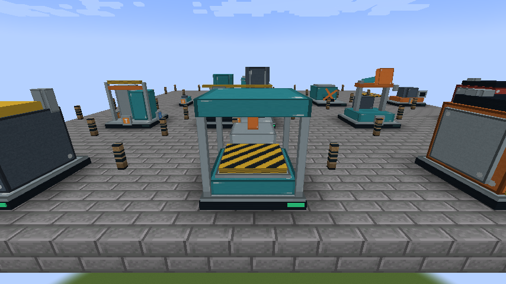

# Цельные модели машин — 0.11.0

Все 16 текущих крупных типов имеют оригинальную геометрию, созданную для FactoryCraft: бур, две печи, сборщик, угольный генератор, нефтяная помпа, НПЗ, химический завод, котёл, паровой двигатель, резервуар, насос, разделитель, лаборатория и сборочный автомат 2. Их X/Z размеры и высоты берутся из MachineProfile; [MACHINE_DIMENSIONS.md](MACHINE_DIMENSIONS.md) остаётся таблицей установки. Это собственная промышленная графика, без извлечённых моделей или текстур Factorio.

Корпус выглядит одной машиной. На границах структурных блоков поверхности делятся с непрерывными UV, без новых внутренних крышек; каждый фрагмент запекается в свой чанк. Для отрисовки части не требуется читать контроллер или соседний чанк. Повороты и варианты индикаторов запекаются при загрузке ресурсов. Рама и промежутки внутри модели сохраняют полный зарезервированный объём с прежней коллизией; свободный на вид проём не является проходом или местом для установки другого блока.

Бур вращает инструмент, сборщик двигает пресс, генератор и НПЗ вращают вентиляторы, помпа качает балансир, химический завод вращает мешалку, паровой двигатель — маховик. Печи и котёл показывают тепло при работе. Эти детали используют отдельный клиентский рендерер и останавливаются по синхронизированному состоянию машины. Они не считают рецепты, FE, жидкость или скорость производства. Фаза анимации после перезагрузки начинается заново; производственное состояние сохраняется сервером. Насос имеет анимированную рабочую поверхность, резервуар статичен, дорожки разделителя анимированы как обычная лента.

Патрубки находятся на настоящих фиксированных портах нижнего уровня: **синий со стрелкой — вход**, **оранжевый с обратной стрелкой — выход**, **бирюзовый с двумя стрелками — двусторонний**. Входы расположены сзади/слева, выходы спереди/справа согласно существующей системе жидкостей. Паровой двигатель имеет только вход, нефтяная помпа — только выход. У резервуара отмечены удобные точки на четырёх боках и сверху, однако capability по-прежнему работает на любой наружной грани. Уровень жидкости виден в меню; динамический уровень внутри 3D бака пока не рисуется. Свечение не добавляет свет в мир.

`/factorycraft showroom` (права администратора) создаёт выставку всех 16 типов. Нужна полностью загруженная свободная область 32×6×32 от позиции игрока + (3,0,3); существующие блоки не заменяются. Машины получают конечные входы и обычное питание/рецепты, а не поддельное состояние работы. Они могут остановиться, израсходовав топливо/сырьё или заполнив выход. Это инструмент ручной проверки моделей, не стартовая фабрика в выживании.

Генерация ресурсов: `python tools/generate_resources.py`. Модели/текстуры машин создаёт `tools/machine_geometry.py`, размеры читает из Java. Статическая геометрия — `models/block/machine_shell.json` с загрузчиком `factorycraft:machine`; нормализованные item/moving модели используют стандартный JSON Minecraft. `CellMeshTest` проверяет сохранение площади поверхностей, дробные координаты, UV и границы. Native GameTests проверяют локальные координаты модели всех профилей во всех поворотах.

НПЗ 0.8.0 дополнен настоящим третьим патрубком спереди слева; оранжевая стрелка и цифра **3** соответствуют выходу тяжёлой нефти продвинутого рецепта. Остальная геометрия и габариты сохранены. В меню пять строк жидкости; текстуры новых жидкостей/вёдер и аккумулятора генерируются тем же скриптом.

Лаборатория 0.9.0 занимает 3×3×3: собственная рама, стеклянные сосуды и рабочая мешалка. Она использует тот же механизм запекания частей и остановки анимации по серверному состоянию. Выставка `/factorycraft showroom` пока содержит прежние 13 типов; рабочая лаборатория проверяется через `/factorycraft researchworks`.

Текстуры предметов из обновлений main `ce4a6a2` / `1266cd3` сохранены побайтно. `tools/item_artwork.json` отделяет эти готовые PNG от процедурных ресурсов: генератор их не перезаписывает и сообщает об отсутствии файла. Изображения будущих научных пакетов/компонентов сами по себе не регистрируют игровые предметы.

Сборщик 2 использует цельную раму/пресс с дополнительными синими коллекторными стойками и четырьмя маркированными патрубками. Имя профиля с цифрой включается в генерацию геометрии; серверная проверка ресурсов требует модель для каждого MachineProfile. Выставка теперь размещает все 15 профилей; новый сборщик получает конечные двигатели, схемы и смазку для реального производства.

Маяк 0.11.0 имеет собственный корпус, мачту и вращаемую при питании антенну; статические поверхности остаются в чанковых мешах. Выставка включает его геометрию; действующий маяк с конечным топливом и двумя реальными линиями проверяется через `/factorycraft moduleworks`.
