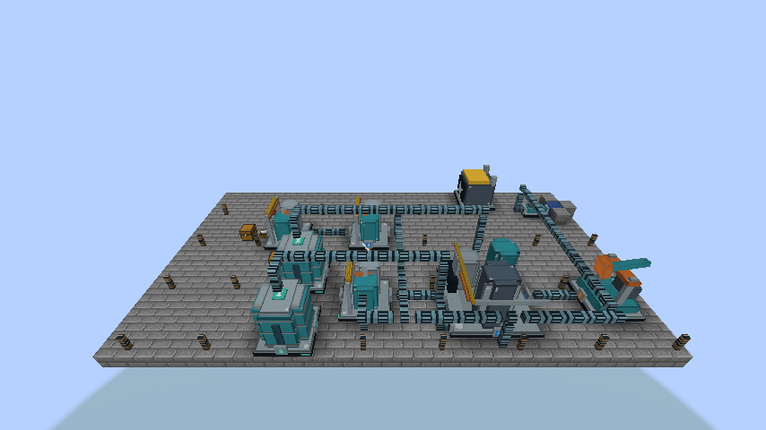
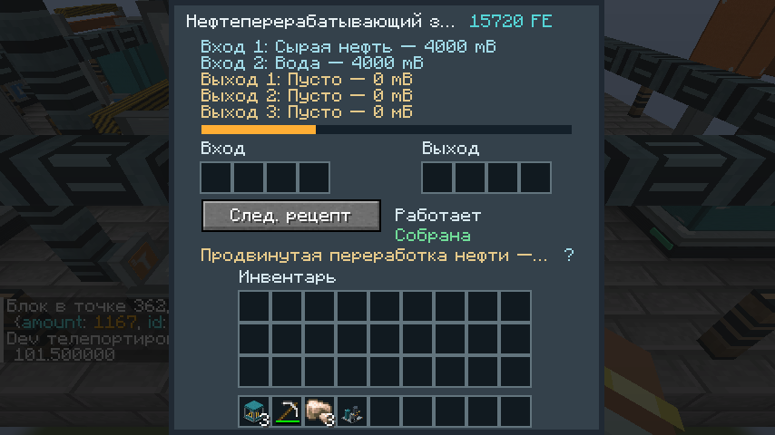
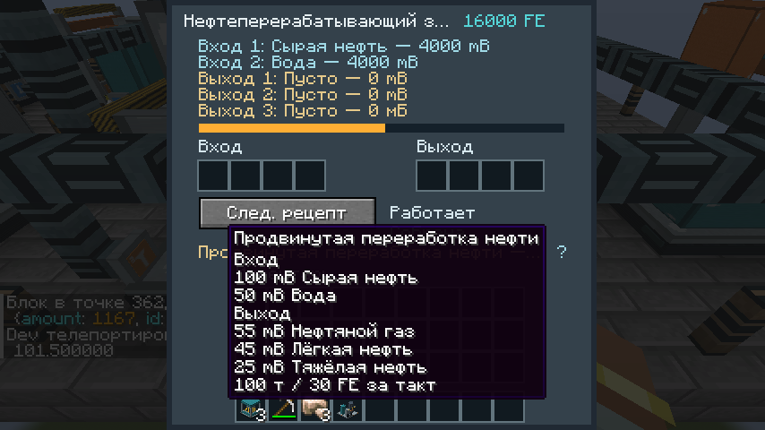

# Petroleum and mixed processing — 0.8.0

Minecraft **1.21.1 / NeoForge 21.1.252 / Java 21**. Finite extraction, basic/advanced refining, cracking, lubricant, sulfur, acid, plastic and batteries work with existing full-size machines, pole grids, pipes, inserters and vanilla chests. Research and later production chains remain incomplete.

## Production balance

| Device / recipe | Inputs | Results | Time | FE/work tick |
|---|---|---|---:|---:|
| Pumpjack | finite oil beneath it | up to 10 mB crude/tick | 1 tick | 15 |
| Basic oil processing | 100 crude | 45 gas | 100 ticks | 30 |
| Advanced oil processing | 100 crude + 50 water | 55 gas + 45 light oil + 25 heavy oil | 100 ticks | 30 |
| Heavy oil cracking | 40 heavy oil + 30 water | 30 light oil | 40 ticks | 20 |
| Light oil cracking | 30 light oil + 30 water | 20 gas | 40 ticks | 20 |
| Lubricant | 10 heavy oil | 10 lubricant | 20 ticks | 20 |
| Plastic | 20 gas + 1 coal | 2 plastic bars | 20 ticks | 20 |
| Sulfur | 30 gas + 30 water | 2 sulfur | 20 ticks | 20 |
| Sulfuric acid | 100 water + 5 sulfur + 1 iron plate | 50 acid | 20 ticks | 20 |
| Battery | 20 acid + 1 iron plate + 1 copper plate | 1 battery | 80 ticks | 20 |
| Advanced circuit (assembler) | 2 circuits + 4 wire + 2 plastic | 1 advanced circuit | 120 ticks | 24 |

Fluid quantities are mB; 20 Minecraft ticks = one second. These are Factorio-style recipe proportions with explicit Minecraft FE costs, not universal power/fluid parity. Only the refinery has **two input / three output** 4000-mB cells; chemical plants retain two input / two output cells. Pumpjacks retain the old four-cell format and use their first output. Existing item, steam and basic-oil recipes remain readable and usable.

Recipes reserve the entire item/fluid output batch before using FE. A full **third** output, incompatible fluid components, missing inputs or insufficient power pauses work. Per-tick FE pays for saved progress; ingredients are consumed only at completion. All fluid cells, item slots and progress commit before notifications. Simulation does not mutate owners. An edited recipe's canonical definition cannot inherit another definition's work. Item ingredients use shared greedy reservation; put specific overlapping predicates first. No conversion claims conservation of raw volume across different chemicals: the exact recipe stoichiometry is the ledger.

## Finite deposits

Oil-bearing rock generates in new Overworld chunks at Y 16–80, by default one small group in eight chunks with up to four replacement attempts. The BE-aware custom oil feature writes through the supplied worldgen region; it does not use vanilla OreFeature's direct section writes. Each newly initialized deposit holds **64000 mB** by default. `oilDepositRichness` in server config affects new initialization only. Initialized zero stays exhausted; no deposit block item or recipe regenerates oil. Right-click reads remaining stock. Breaking the rock deliberately destroys unused oil and drops cobblestone; pistons cannot move it.

The powered pumpjack searches the loaded 3×3 area below its base center, up to eight blocks deep, with a cached target and 20-tick retry for invalid/empty searches. It never forces chunks and spends no extraction FE when output is full or no reserve is available. Worldgen frequency/biomes/height use the existing configured/placed-feature and biome-modifier JSON. No retrogen or new oil-field distribution is added by 0.8.0.

## One item / whole structure and physical ports

One item forms the complete 5×4×5 refinery around the selected **horizontal base center**. Internal controllers stay front-left-bottom for 0.6.0+ compatibility; their coordinates are not the player's targeting origin. Protection, loaded-volume validation, centered previews and snapshot rollback remain. Parts contain position/UUID only. Breaking any part or removing with a wrench returns at most one portable machine with the sole inventory/fluids/FE/progress; placement binds fresh identities. See MACHINE_DIMENSIONS.md.

Lower-layer refinery ports, relative to its internal controller (F = forward, R = right):

| Cell / persisted key | Side | Physical block | Adjacent connection | Advanced product |
|---|---|---|---|---|
| Input 1 / Fluid0 | rear −F | controller + 2R − 4F | controller + 2R − 5F | crude |
| Input 2 / Fluid1 | left −R | controller − 2F | controller − R − 2F | water |
| Output 1 / Fluid2 | front +F | controller + 2R | controller + 2R + F | gas |
| Output 2 / Fluid3 | right +R | controller + 4R − 2F | controller + 5R − 2F | light oil |
| **Output 3 / Fluid4** | **front +F** | **controller** | **controller + F** | **heavy oil** |

The new output is **front-left**, marked with an orange arrow and **3**. Existing ports and stored fluids never move or swap. Old two-output refinery NBT gains an empty fifth cell; no stock is invented. Existing Fluid3 contents remain in output 2 even if they block a newly selected advanced recipe. Remove incompatible fluid through the maintenance capability/buckets before switching production.

Chemical plants keep rear/left inputs and front/right outputs at the centered boundary cells of their 3×3 footprint. Heavy/light cracking takes oil at input 1, water at input 2; lubricant takes heavy oil at input 1. Sulfur takes gas at input 1/water at input 2. Acid takes water at input 1 plus item-fed sulfur/iron; batteries take acid at input 1 plus iron/copper. Basic refining needs only input 1/output 1. Items enter via ordinary guarded capabilities/inserters, not fluid ports.

Each nozzle pulls/pushes up to **100 mB/tick** to adjacent canonical FactoryCraft fluid endpoints. Pipes still use the finite local-pressure approximation in FLUIDS.md. Every cached capability rechecks canonical loaded ownership and full assembly readiness; unavailable parts pause production and transfer before chunk serialization. Unsided maintenance access enumerates all cells (five at a refinery), fills inputs and drains recoverable contents. There is no dedicated tank-flush button or arbitrary external-tank adjacency scanner. Other mods can use the guarded NeoForge capabilities.

Crude, gas, heavy/light oil, lubricant and acid have native plain buckets and original textures. Component-bearing fluids refuse lossy bucket conversion; portable machines/tanks preserve full native components and restored overflow. Lubricant is currently produced/stored/transported; engines consuming it and accumulator recipes consuming batteries are future progression work.

## Interface and automatic examples

Right-click any machine part for the controller menu. Five refinery rows show every cell; hovering a row gives full content and physical port. Hover the recipe line / `?` for counted inputs, **all three** outputs, duration and FE. Named EN/RU recipes distinguish basic and advanced oil even though both make gas. Datapack recipes without a translation fall back to the first result's name. Selection persists by ID; use the select button to prevent auto mode from choosing another matching recipe. No JEI is required.

`/factorycraft oilworks` retains the 30×8×13 finite oil → plastic example. `/factorycraft petrochemistry` requires a loaded clear **30×8×16** region from player position + (3,0,3). It builds a real native water intake/pump, finite oil deposit/pumpjack, explicitly advanced refinery, three chemical plants, isolated gas/heavy/light/acid pipe networks, two byproduct tanks, inserters/chests and pole power. Inputs are eight generator coal, sixteen iron plates for acid, eight iron/eight copper plates for batteries. It injects **no crude, gas, sulfur, acid or battery**. Refill raw supplies and fuel for continued work. Heavy/light tank backpressure correctly stops refining when full; add cracking/lubricant production to use them.

The example's refinery faces east. From the machine-layer origin: refinery controller (11,0,1), heavy tank (19,0,0), light tank (19,0,4), sulfur plant (17,0,2), acid plant (17,0,8), battery plant (23,0,8), final chest (25,0,9). Water runs at Y+2, byproduct lines at Y+4 with an offset riser to avoid mixing at crossings. Finite local-pressure pipes need initial fill; byproduct reservoirs receive fluid after the empty lines build pressure. These are administrative fixture coordinates; survival placement remains centered.







## Datapack and saved-data format

Old `factorycraft:processing`, `factorycraft:boiling` and all old chemistry field names/wire field order remain. Advanced refining uses:

```json
{
  "type": "factorycraft:chemistry",
  "machine": "oil_refinery",
  "fluids": [
    {"fluid": "factorycraft:crude_oil", "amount": 100},
    {"fluid": "minecraft:water", "amount": 50}
  ],
  "fluid_results": [
    {"id": "factorycraft:petroleum_gas", "amount": 55},
    {"id": "factorycraft:light_oil", "amount": 45},
    {"id": "factorycraft:heavy_oil", "amount": 25}
  ],
  "ticks": 100,
  "energy": 30
}
```

Lists may omit unused categories. At least one input/result is required. Up to four counted item inputs/results, two fluid inputs and **three refinery / two chemical-plant fluid results** are allowed. Fluid arrays map directly to numbered ports; no automatic remapping. Amounts are 1–4000 mB, ticks 1–72000, FE/work tick 1–16000; item outputs must fit native stack limits. NeoForge SizedFluidIngredient.FLAT_CODEC supports tags/predicates and native FluidStack results preserve components. Constructors, JSON list bounds and native stream decoding reject unsupported counts.

Only refinery `Petroleum.Schema` becomes **2**, storing Fluid0..4. Chemical/pumpjack schema 1 and assembly/part schema 3 stay. Old Fluid0..3, selected ID and canonical Active/progress read unchanged; the absent Fluid4 is empty. Existing 0.6.0+ structures/resources remain, with no relocation, refill, capacity truncation or diagnostic-world reset. Full 0.7.0 benchmark compatibility and old/new native disk fixtures are checked independently.

## Validation and limits

See VALIDATION.md: five-owner transaction/JUnit coverage, native three-output/blocked/mismatched/underpowered conversion, all nozzle rotations, actual pipes/cached unload guards, recipe/bucket codecs, five-cell portable data with components/overflow, live reconstruction and exact separate-process four-chunk persistence. The complete finite-source-to-battery line counts crude/gas/sulfur/acid/batteries in every machine, pipe, tank, chest and inserter hand; it also checks both byproducts and iron/copper balance. No intermediate supplies are manually injected into that test.

These checks do not establish two real network-client interoperability, natural player-distance chunk timing, final chemical art, pipe temperature or a TPS target for a giant petrochemical factory. Next work: team labs/science/research and recipe gating, followed by the remaining roadmap.

## 0.10.0 continuation

The same mixed-transaction adapter now also serves a 3×3×3 assembling machine 2, with lubricant/electric-engine and acid/processor recipes plus original dry assembler recipes. Existing chemical/refinery machine bounds, JSON field names, wire order, port order and saved canonical signatures are retained. Its new recipe machine allows 0–100000 FE/t to represent the original processing definitions; refinery/chemical-plant definitions still require 1–16000. Invalid JSON definitions return codec errors. Exact-volume canister recovery removes input leftovers through a validated menu transaction; see FLUIDS.md / PROGRESSION.md.
