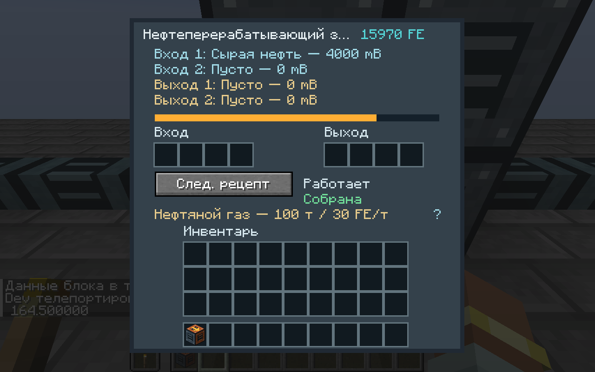
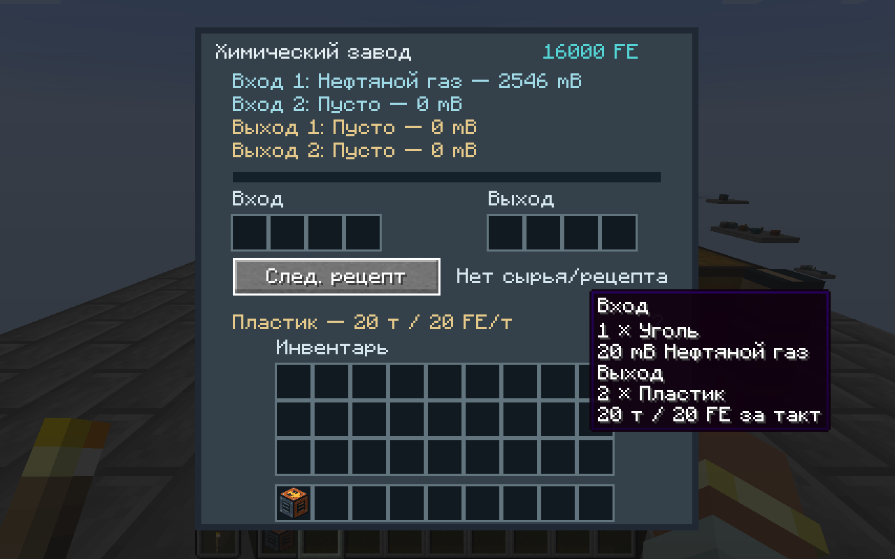

# Petroleum and mixed processing — 0.6.0

Target: Minecraft 1.21.1 / NeoForge 21.1.252 / Java 21. This is the first usable petroleum chain, integrated with existing poles, fluid pipes, inserters and the assembler. Advanced refining is not complete.

## Production balance

| Device / recipe | Inputs | Results | Time | FE per work tick |
|---|---|---|---:|---:|
| Pumpjack | finite oil deposit beneath it | up to 10 mB crude per tick | 1 tick | 15 |
| Basic oil processing | 100 mB crude | 45 mB petroleum gas | 100 ticks | 30 |
| Plastic | 20 mB gas + 1 coal | 2 plastic bars | 20 ticks | 20 |
| Sulfur | 30 mB gas + 30 mB water | 2 sulfur | 20 ticks | 20 |
| Advanced circuit (old assembler) | 2 circuits + 4 copper wire + 2 plastic | 1 advanced circuit | 120 ticks | 24 |

20 Minecraft ticks = one simulation second. Basic oil/plastic/sulfur use the Factorio-style recipe proportions shown above, with explicit Minecraft FE costs. This does not establish universal Factorio power/fluid parity. Each processor has two 4000-mB input tanks, two 4000-mB output tanks, four item input slots and four output slots. The pumpjack uses only its first output tank. Steam/power and previous item recipes remain usable.

A mixed recipe reserves the entire batch output, including every item result and fluid result, before using energy. Full outputs, mismatched fluid components, missing inputs or insufficient FE pause work. Per-tick FE pays for persistent progress; counted items/fluids are consumed only at completion. All fluid cells and prevalidated inventory slots commit before observers/neighbor notifications. There is no temporary unowned item or fluid parcel. Matching is ordered by recipe ID; item ingredient counts use a greedy shared reservation, so put more specific overlapping ingredients first, as in the original processing recipes.

## Finite deposits

Oil-bearing rock generates in new Overworld chunks at Y 16–80. The default placement attempts one small group in eight chunks; a group makes up to four bounded replacement attempts, so exposed/non-stone locations can produce fewer blocks or none. The custom `factorycraft:oil_deposit` feature uses worldgen-region block writes so block entities are registered correctly. Vanilla OreFeature's direct section writes are unsuitable for these reservoirs.

Each newly initialized block contains **64000 mB** by default. `oilDepositRichness` in the world's server config changes only new initialization; loaded depleted/reserved blocks never reset. Configuration uses an Initialized flag and an exact persisted remaining amount. No deposit block item or recipe exists that could refill it. Right-click the rock to read the server's remaining amount. Breaking the rock gives cobblestone and destroys unused oil; this is deliberate resource removal, not a transport operation. Pistons cannot move it. An exhausted block changes appearance and stays exhausted after restart.

The electric pumpjack searches the loaded 3×3 area beneath it, up to eight blocks deep. A cached target avoids repeated searches; an empty/invalid search retries every 20 ticks. It never forces chunks. Its front outputs crude; supply FE through poles or the standard input capability. A full output or no oil uses no extraction FE. Pumps need no fuel item. Range, geology and natural distribution have not been statistically surveyed; the actual configured feature has an integration placement test.

Worldgen is configurable through `worldgen/configured_feature/oil_deposit.json`, `worldgen/placed_feature/oil_deposit.json` and `neoforge/biome_modifier/oil_deposit.json`. The configured feature uses the native OreConfiguration codec: target rules, size (bounded to 64 attempts) and air-exposure discard chance; writes remain within a five-block-wide neighborhood. Frequency/height/biomes use standard placement modifiers. Existing chunks are not retro-generated.

## One-item refinery and fluid ports

Place **one oil refinery item** with a free loaded 5×4×5 volume (width × height × depth). It forms the entire structure automatically through the same protected snapshot placement as the industrial furnace. It extends right, upward and backward from the controller. Generated refinery parts are hidden internal blocks, not ingredients; only the controller owns inventory, FE, progress and fluids. Normal protection cancellation rolls back every generated cell and refunds the item. Breaking any part returns one portable refinery item, with the sole resource state inside; no duplicate loose inventory drops occur. Placement removes the old assembly identity from the imported data and binds all new parts to a fresh identity. 0.6.0 requires a new world; old compact saves are not migrated.

For the refinery, use these lower-layer boundary positions relative to the controller (F = forward/top-arrow direction; R = right):

| Tank | Face | Physical block | Neighbor connection |
|---|---|---|---|
| Input 1 | back (−F) | controller + 2R − 4F | controller + 2R − 5F |
| Input 2 | left (−R) | controller − 2F | controller − R − 2F |
| Output 1 | front (+F) | controller + 2R | controller + 2R + F |
| Output 2 | right (+R) | controller + 4R − 2F | controller + 5R − 2F |

The 3×3 chemical plant uses centered rear/front boundary cells for input 1/output 1, and centered left/right cells for input 2/output 2; the 5×5 refinery uses the same relative rule. See MACHINE_DIMENSIONS.md for physical placement. Basic oil uses only input 1/output 1. Plastic uses gas in input 1 and coal in item inputs; sulfur uses gas in input 1/water in input 2. Items move through inserters/hoppers and standard NeoForge item capabilities. Empty unused fluid tanks are not automatically merged or repurposed.

Processors pull/push up to 100 mB per nozzle/tick into adjacent canonical FactoryCraft fluid endpoints, rather than participating as passive pressure nodes. Pipes use FLUIDS.md's finite local-pressure model. Generated-part capabilities recheck loaded part, canonical controller, identity and assembly readiness on every access. When a required part unloads, production and forwarded automation pause; no world access forces another chunk to load. Individual processors retain ordinary BE tickers; no large thermal/chemical TPS claim is made.

Sided fluid capabilities fill inputs and drain outputs. Unsided capability access provides maintenance filling/draining, including input recovery; there is no dedicated player tank-flush UI yet. Native buckets can carry plain crude/gas, but refuse lossy component-bearing conversion just like steam. Portable machines/tanks preserve native FluidStack components. Automatic discovery of arbitrary external mod tanks is not included; other mods can use the standard guarded capabilities.

## Interface and example

Right-click a processor (or any refinery part) for the same controller menu: live tanks, item slots, FE, progress, assembly status and recipe choice. Hover the recipe line / `?` for all counted item/fluid requirements and results, duration and FE per tick. This works without JEI. Selection is saved by recipe ID, and partial progress also records a canonical serialized definition; adding/editing recipes does not reuse another definition's progress. The menu fits the minimum 240-unit GUI height. Full-block synchronization is limited to changed-state updates on a five-tick cadence; this is not a measured multiplayer delta protocol.

`/factorycraft oilworks` needs a loaded empty **30×8×13** area beside the player. It builds a finite reservoir under a pumpjack, pipes, a correctly formed refinery, a chemical plant, poles, generator with eight coal, a separate 32-coal supply chest/inserter, and an output inserter/chest. It never fills crude/gas tanks or supplies plastic directly. The finite coal feed supports 64 plastic bars; refill the feed to continue while oil remains. A normal survival factory obtains deposits by exploration and crafts the three machines from the recipe book.





## Datapack recipes

Old `factorycraft:processing` and `factorycraft:boiling` formats are unchanged. The new type separates item and fixed-port fluid requirements:

```json
{
  "type": "factorycraft:chemistry",
  "machine": "chemical_plant",
  "items": [{"ingredient": {"item": "minecraft:coal"}, "count": 1}],
  "fluids": [{"fluid": "factorycraft:petroleum_gas", "amount": 20}],
  "results": [{"id": "factorycraft:plastic_bar", "count": 2}],
  "fluid_results": [],
  "ticks": 20,
  "energy": 20
}
```

`machine` is `oil_refinery` or `chemical_plant`. Lists may omit unused categories. There must be at least one input and result. Item inputs/results are at most four, fluid inputs/results at most two, fluid amounts 1–4000 mB, duration 1–72000 ticks and FE/work tick 1–16000. Item results must fit the item's native stack limit. Item ingredients use the existing counted native Ingredient codec; fluid ingredients use NeoForge SizedFluidIngredient.FLAT_CODEC (including tags/custom predicates). Fluid results use native FluidStack components. Array index maps directly to its numbered fluid port. Native stream list sizes and constructors also validate bounds; ChemicalInput's recipe API checks fluids as well as items.

## Validation and remaining work

See VALIDATION.md: independent transaction tests, real dedicated block/capability tests, actual item placement/protection, finite source-to-chest material ledger, BE-aware feature placement, live partial reconstruction and separate-JVM exact four-chunk refinery state. The inactive exact-value disk fixture complements live production tests; it is not a natural player-distance unload test. Client screenshots and observed production/save/reload are recorded there.

Next: third fluid output / advanced oil (heavy + light + gas), cracking, lubricant, sulfuric acid and batteries; then team research and recipe gating. Current two-output recipes do not implement advanced refining. Two real clients, external mod interoperability, sampled natural deposit distribution, underground pipes and large active petroleum factories remain unverified.
