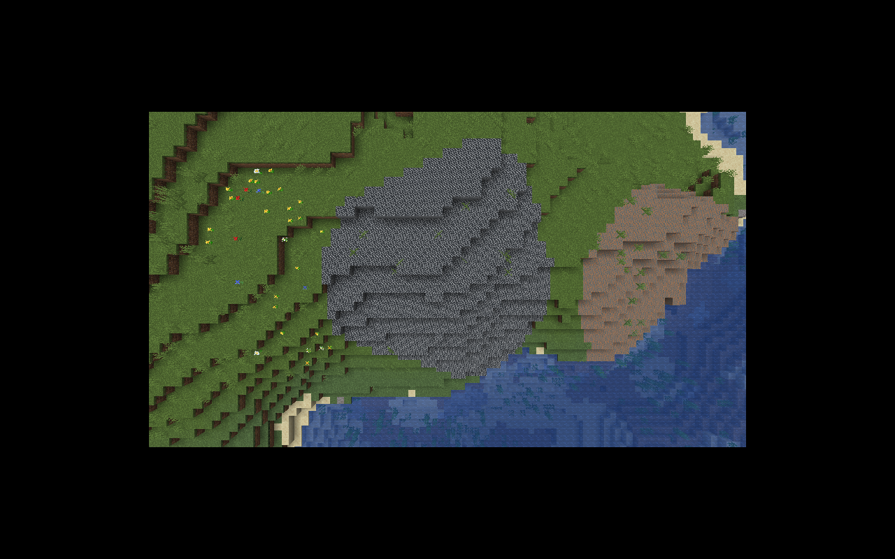

# Крупные ресурсные жилы — 0.6.1

Железо, медь, уголь и камень генерируются **крупными поверхностными полями**, как залежи Factorio, с неровными границами и более богатым центром. Поля следуют рельефу Minecraft, состоят из отдельных исчерпаемых плиток и могут пересекать несколько чанков. Под водой ресурс не размещается. Нефть пока сохраняет отдельную модель залежей (`PETROLEUM.md`).

## Настройки

Файл **`config/factorycraft-worldgen.toml`** создаётся при первом запуске мода на клиенте/сервере. Измените его перед запуском мира:

```toml
minVeinRadius = 8
maxVeinRadius = 20
minTileStock = 500
maxTileStock = 5000
veinSpacingChunks = 6
```

* `minVeinRadius` / `maxVeinRadius`: диапазон номинального радиуса поля в блоках, допустимо 4–48. По умолчанию диаметр порядка 16–40 блоков; неровные края лежат внутри выбранного радиуса.
* `minTileStock` / `maxTileStock`: конечный запас одной сгенерированной плитки, допустимо 1–10 000 000. У края запас ближе к минимуму, к центру возрастает; все значения остаются в заданном диапазоне.
* `veinSpacingChunks`: сторона ячейки сетки, в каждой которой выбирается один центр поля **для каждого ресурса**. Допустимо 2–32 чанка. Большее значение делает жилы реже. Вода/неподходящая поверхность могут уменьшать или исключать поле, разные ресурсы могут перекрывать часть области.

Перепутанные границы TOML нормализуются (меньшее значение становится минимумом). Настройки требуют перезапуска и действуют в **новых чанках**; уже сохранённый запас не переписывается. Это общая конфигурация генерации, отдельного окна настройки мира пока нет. Создавать новый мир после 0.6.0 не требуется: исследуйте новые области. Старые отдельные залежи остаются с прежним содержимым.

## Добыча и сохранение

Кирка добывает одну единицу за завершённое разрушение, кладёт её в инвентарь и оставляет плитку до истощения. ПКМ сообщает оставшийся запас. Неверный инструмент или полный инвентарь не уменьшают запас; износ инструмента обрабатывает обычный mining pipeline Minecraft.

Электробур занимает 3×3, теперь ставится **от центра основания**, ищет ресурсные плитки в области 5×5 на глубину восьми блоков. По умолчанию одна единица за 60 питаемых тактов, 10 FE/такт. Нет энергии или места на выходе — нет списания. Последняя единица превращает плитку в воздух. Ванильные руды остаются обычными ручными ресурсами; бур разрабатывает заводские залежи.

Железо → raw iron, медь → raw copper, уголь → coal, камень → cobblestone. У залежей нет предмета/рецепта, восстанавливающего богатую плитку повторной установкой. Творческое разрушение удаляет плитку; взрыв не превращает весь запас в предметы.

`ResourceDepositBlockEntity` сохраняет `Schema=1`, `Initialized`, `Remaining`; нулевой запас никогда не считается неинициализированным. Сгенерированный запас записывается сразу, до загрузки чанка в симуляцию. Никакого тика на каждую плитку нет. Ранее сохранённые запасы и схемы 0.6.0 читаются без изменений. `oreTileRichness` старой серверной конфигурации остаётся только значением для служебных `/setblock`/демо-плиток, а не генератором естественных жил.

## Datapack

`factorycraft:resource_patch` теперь использует отдельный формат больших полей (старый ore-style JSON этого feature нужно обновить):

```json
{
  "type": "factorycraft:resource_patch",
  "config": {
    "state": {"Name": "factorycraft:iron_ore"},
    "salt": 920174,
    "use_world_settings": false,
    "vein": {
      "min_radius": 8, "max_radius": 20,
      "min_stock": 500, "max_stock": 5000,
      "spacing_chunks": 6
    }
  }
}
```

`use_world_settings=true` берёт диапазоны из TOML; `false` — из `vein`, отдельно для этого ресурса. `salt` разделяет расположение разных ресурсов. Некорректные диапазоны JSON отклоняются кодеком. Встроенный placed feature вызывается один раз для чанка, без старых `count`, `in_square` и случайной подземной высоты; biome modifier использует Overworld и шаг `underground_ores` до растительности.

`ResourceVeins` вычисляет контур/запас по seed и мировым координатам. Каждый вызов `ResourceVeinFeature` записывает **только текущий чанк**, используя переданный генератором WorldGenLevel. Соседние чанки независимо восстанавливают ту же часть поля: без принудительной загрузки, обрезания швов и зависимости от порядка генерации. Инициализация BE в регионе не вызывает ServerLevel/соседние уведомления из фонового потока. Повторный вызов не заменяет существующие ресурсные плитки и не восстанавливает их содержимое. Ретро-генерации в старых чанках нет.


