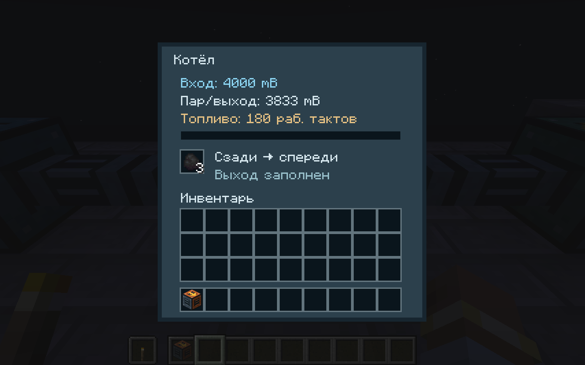
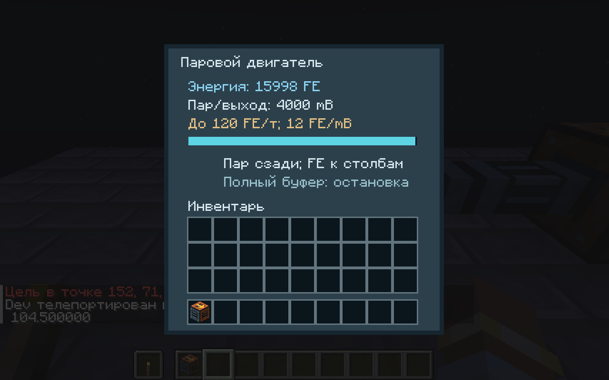

# Steam power — 0.25.0

Minecraft 1.21.1 / NeoForge 21.1.252 / Java 21. The thermal chain uses an automatic 3×2 boiler and 3×5 engine (both height 2). One item forms each entire structure. Physical INPUT/OUTPUT/BOTH connections follow machine_layouts.json independently of the controller; see PETROLEUM.md and MACHINE_DIMENSIONS.md.

## Balance

| Device | Input | Output | Limit / behavior |
|---|---|---|---|
| Boiler | 2000 mB water; 20 fueled working ticks | 2000 mB steam | one 1-second batch at 20 TPS; pauses without input/fuel/full result space |
| Steam engine | up to 100 mB steam per tick | 6 FE / 5 mB, up to 120 FE/t | 16000 FE buffer; retains fractional FE when the buffer blocks |
| Thermal fluid ports | descriptor-defined input/output/BOTH faces | finite cell transfers | 40000-mB buffer-derived nominal 120000 mB/t, bounded by segment pressure; each cell 40000 mB |

A boiler uses vanilla NeoForge smelting fuel durations, burning one stored fuel tick per successful work tick. One coal (1600 fuel ticks) processes 160000 mB water into steam; an engine can convert that to **192000 gross FE**. Pump power and other consumers reduce net available energy. This balance is a documented Minecraft FE approximation, not a literal Factorio joule conversion. The old coal generator still gives up to 80 FE per working fuel tick. Ambient cooling, steam temperature-dependent power, heat pipes and nuclear turbines are not simulated. Steam's fluid type has a nominal 438 K / 165 °C label; it is not an independent temperature field.

Input is consumed only at batch completion after output space is checked again. Partial progress and unspent fuel ticks persist; unavailable inputs or blocked output pause both progress and fuel use. A changed recipe definition starts its own progress. Heat already used for previous work is not refunded when definitions change. Container fuels retain their crafting remainder (e.g. empty lava bucket); automation can remove that remainder. Stacked container fuels are not overwritten.

The engine uses an exact integer numerator: each consumed mB adds six fifths of an FE. The remainder 0–4 is persisted with energy, chunks and portable items, including an otherwise empty engine. No fraction is discarded and no work is inferred from elapsed offline time. From 20000 mB without extraction it fills to 16000 FE, keeps remainder 4/5 FE and 6666 mB steam; extracting two FE admits exactly one further mB and restores a full buffer with zero remainder. The invariant is `5 × (stored + delivered FE) + remainder + 6 × remaining steam = 6 × initial steam`. Oversized saved FE remains drainable and generation pauses until space exists. No external FE input is accepted.

The 200-Factorio-unit/second boiler and FE conversion retain FactoryCraft's existing thermal timing/fuel adaptation, not literal Factorio thermal joules. Only fluid quantities scale by ten; gross FE per coal is unchanged. Physical BOTH ports still use descriptor-defined pressure exchange; a finite test supply must contain enough water to reach the 2000-mB recipe threshold after pressure balancing.

## Building and interacting

1. Supply water to the boiler's rear. Its top arrow points toward the front steam outlet. Put fuel in its GUI slot or insert it through the NeoForge item capability using an inserter/hopper. A boiler needs fuel, not electricity.
2. Connect steam pipes to the boiler's front, then the engine's rear. Thermal machines actively pull/push adjacent FactoryCraft fluid cells; connected passive pipes share segments as described in FLUIDS.md. Wrong fluids/components cannot overwrite a stored cell. Pumps are directional boundaries. No world chunks are forced.
3. Connect poles by actual copper wires and intersect their square supply area with the engine/consumer foundations (see [ELECTRICITY.md](ELECTRICITY.md), current 0.20 rules). It supplies the same graph as coal generators; generated FE can also be extracted through the standard NeoForge capability. No automatic push into external FE blocks is included.
4. The electric water pump needs a bootstrap source. Start it from the coal generator; once steam generation is operating, remove that generator if desired. The engine can then sustain the pump while powering a basic factory. The dedicated GameTest uses only a finite 400-FE starting charge and proves subsequent pump/furnace operation without any coal generator.
5. Right-click for volume/fuel/progress/FE; a factory wrench rotates. Side fluid ports accept buckets through standard NeoForge interaction. Plain steam has a bucket; native buckets cannot retain fluid components, so component-bearing steam refuses bucket transfer without draining it. Use portable tanks or component-aware fluid containers for those stacks. Actual empty-bucket interaction also protects component-bearing water/other fluids in FactoryCraft blocks. Steam stays container-only: no steam world block or infinite source generation. Only descriptor-defined physical ports work, including BOTH ports with separate channels. Arbitrary casing and unsided capability access are blocked; use the guarded canister recovery UI for maintenance.
6. Breaking a machine returns one item retaining its sole fuel inventory, unspent fuel heat, progress/recipe identity, fluids/components and generated FE. Placing it restores state. Empty machines stack normally. Creative breaking follows vanilla no-drop behavior. No extra inventory drops duplicate the portable contents.

Survival recipes are unlocked by acquiring iron, including for existing saves. Boiler: 5 iron plates, 2 pipes, vanilla furnace, gear. Engine: 4 iron plates, 2 gears, 2 pipes, copper plate. See `craft_boiler.json` and `craft_steam_engine.json` for exact crafting grids.

`/factorycraft steamworks` requires a loaded empty 30×8×13 area beside the player. It builds enclosed water, electric pump, pipes, boiler with eight coal, engine, poles, a bootstrap generator with eight coal and a furnace with eight raw iron. It does not directly fill steam/output plates. `/factorycraft power` reports the shared grid. The generator may be removed after the engine starts; `/factorycraft waterworks` and old factory examples remain available.

## Datapack boiling recipes

`data/<namespace>/recipe/<name>.json`:

```json
{
  "type": "factorycraft:boiling",
  "input": {"fluid": "minecraft:water", "amount": 2000},
  "result": {"id": "factorycraft:steam", "amount": 2000},
  "ticks": 20
}
```

Input uses NeoForge `SizedFluidIngredient.FLAT_CODEC`; fluid tags/custom fluid ingredients are supported by that codec. Output uses the native FluidStack codec, including optional components. Amounts are 1–40000 mB and duration 1–72000 ticks; oversized recipes are rejected at decode. Matching is automatic, ordered by recipe ID; this first fluid machine has no manual recipe selector. Definition caches refresh at most once per 20 ticks. A canonical codec-encoded definition is stored with progress, preserving identity across server restarts and preventing work from an edited definition being reused.

Boiling handles one counted fluid input/output with fuel heat. Mixed item/fluid chemistry, advanced refining and production modules are implemented separately; see PETROLEUM.md. The 0.25 recipe schema intentionally does not migrate older FactoryCraft formats. Thermal module effects and temperature physics are not introduced.





## Evidence and limits

See VALIDATION.md for commands/results. Independent tests cover atomic conversion callbacks, no-fuel/no-input/backpressure, exact progress restoration, changed definitions, FE quanta/overflow and complete material/fuel/energy ledgers. Dedicated tests exercise real fluid/item/FE APIs, buckets, fuel remainders, actual portable item placement, rotation/unload guards, codec round-trips, partial reconstruction, finite pipe transport and source-water-powered production. A detached two-chunk fixture verifies exact saved fuel/progress/fluids/FE in separate JVMs; this is not natural player-distance unload coverage.

The machines currently use ordinary server BE tickers with two precomputed neighbor positions, canonical chunk checks, per-boiler recipe caches and changed-state synchronization every five ticks at most. There is no global world scan or off-thread world access. Large active thermal factories, two real clients, other-mod interoperability and temperature physics are not benchmarked. Existing full-factory regression tests contain no thermal load. Actual basic/advanced petroleum, chemistry and module chains remain mandatory native tests. No subsequent feature work starts automatically.

## Fluid segment integration (0.24.0)

Boiler/engine recipe quantities, fuel and 12-FE steam quanta are unchanged. Water/steam channels remain sole machine-owned buffers; physical BOTH water ports propagate water filters to adjacent passive segments, while steam has its separate channel/filter. Conflicting bidirectional fluids do not merge. Pipes and tanks use the same segment owner for active ports and circuits. Pump rate is now 60 mB/t at normal pressure (20 FE/working tick); source-water remains an explicit Minecraft feature. See FLUIDS.md and VALIDATION.md.
